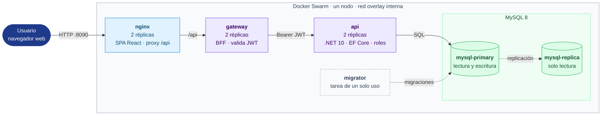

# ClinicaCore — Healthcare (EMR)

Plataforma web de registros médicos electrónicos (EMR) para clínicas y hospitales, construida con **.NET 10**, **React** y **MySQL 8**, y desplegada en contenedores sobre **Docker Swarm** con base de datos replicada (primario–réplica).

El sistema administra pacientes, médicos, citas, historial clínico, diagnósticos, recetas, estudios, resultados tratantes, kardex, facturación, proveedores y cobertura de seguros. La autenticación es con **JWT** y autorización por roles.

## Stack

| Capa | Tecnología |
| --- | --- |
| Frontend | React 19 + TypeScript (Vite), servido como estáticos por nginx |
| Punto de entrada | nginx (sirve el SPA y hace proxy de `/api`) |
| Backend | ASP.NET Core en .NET 10: Gateway/BFF + Api de dominio |
| Datos | EF Core 9.0.x (Pomelo + MySqlConnector) sobre MySQL 8 |
| Orquestación | Docker Swarm (un solo nodo), `docker stack deploy` |

## Arquitectura



- **nginx** es el único servicio publicado al host (puerto `8090`). Todo lo demás vive en una red overlay interna.
- **gateway** es el único backend visible; propaga el `Authorization: Bearer` a la Api de dominio.
- **mysql-primary** acepta escrituras; **mysql-replica** las recibe por replicación y queda en solo lectura.
- **migrator** es una tarea de un solo uso que aplica las migraciones de EF Core al primario.

Diagrama y topología detallados en [`docs/fase4-despliegue.md`](docs/fase4-despliegue.md).

## Requisitos

- Docker Engine con Swarm (se inicializa solo con el paso 0). Verificado en Docker 28.5.1.
- Para desarrollo fuera de contenedores: .NET SDK 10, Node 20+ y npm.

## Cómo levantarlo (despliegue completo en contenedores)

Desde la raíz del repo, en orden. Los scripts son idempotentes.

```bash
bash infra/scripts/00-init-swarm.sh        # inicializa Swarm si no está activo
bash infra/scripts/01-crear-secrets.sh     # crea los 4 secrets (no se commitean)
bash infra/scripts/02-build-imagenes.sh    # construye las 4 imágenes :local
bash infra/scripts/03-deploy.sh            # docker stack deploy clinicacore
bash infra/scripts/04-migrar.sh            # aplica migraciones EF al primario
bash infra/scripts/05-verificar-salud.sh   # espera réplicas running y /healthz
```

### Dónde queda corriendo

- **Aplicación web:** http://localhost:8090 (el SPA de React servido por nginx).
- **API vía el gateway:** http://localhost:8090/api (p. ej. `POST /api/auth/login`).
- Los servicios `gateway` (5000), `api` (5080) y MySQL (3306) **no** se publican al host; solo son accesibles dentro de la red overlay.

> Nota: el stack publica nginx en el puerto `8090` del host (el `8080` suele estar ocupado por otro proyecto). Para cambiarlo, edita el mapeo de `nginx` en `infra/stack.yml` (`8090:80`) y vuelve a desplegar.

### Primer uso

El sistema arranca **sin usuarios**: hay que crear el primero antes de poder entrar. Si vas a usar los datos de demostración, puedes saltarte esta sección: el [paso opcional](#paso-opcional--cargar-datos-de-demostración) crea un usuario por rol. Si no, sigue estos tres pasos por API.

**Paso 1 — Registrar el primer administrador.** Mientras no exista ningún usuario, `register` acepta una petición sin token, y solo para crear un usuario con rol `Admin`:

```bash
curl -X POST http://localhost:8090/api/auth/register \
  -H 'Content-Type: application/json' \
  -d '{"correo":"admin@clinicacore.test","password":"Admin123!","rol":"Admin"}'
```

Devuelve `201 Created` con los datos del usuario creado (sin contraseña). A partir de ese momento el registro se cierra: sin token responde `401`, y con un rol distinto de `Admin` responde `403`. Los siguientes usuarios los crea el administrador desde la pantalla **Usuarios** o con `register` enviando su token.

**Paso 2 — Iniciar sesión.** Con las mismas credenciales, pide el token:

```bash
curl -X POST http://localhost:8090/api/auth/login \
  -H 'Content-Type: application/json' \
  -d '{"correo":"admin@clinicacore.test","password":"Admin123!"}'
```

Devuelve `200 OK` con un JWT:

```json
{ "token": "eyJhbGciOiJIUzI1NiIsInR5cCI6IkpXVCJ9...." }
```

**Paso 3 — Usar el token.** Copia el valor de `token` y envíalo en la cabecera `Authorization` de las peticiones protegidas, con el prefijo `Bearer`. Por ejemplo, listar diagnósticos:

```bash
TOKEN="eyJhbGciOiJIUzI1NiIsInR5cCI6IkpXVCJ9...."   # el token del paso 2

curl http://localhost:8090/api/diagnosticos \
  -H "Authorization: Bearer $TOKEN"
```

Sin ese encabezado, los endpoints protegidos responden `401 Unauthorized`; con un rol sin permiso para la operación, responden `403 Forbidden`.

Hay ejemplos de peticiones listos para ejecutar en `backend/gateway/ClinicaCore.Gateway.http` y `backend/api/ClinicaCore.Api.http`.

### Roles y accesos

El sistema define cuatro roles: `Admin`, `Medico`, `Recepcion` y `Lectura`. Toda lectura exige estar autenticado; las escrituras dependen del rol. El backend aplica estos permisos (responde `403`), y la interfaz oculta los botones y pantallas que el rol no puede usar.

| Recurso | Leer | Crear | Editar | Borrar |
|---|---|---|---|---|
| Pacientes | Todos | Admin, Medico, Recepcion | Admin, Medico, Recepcion | Admin (baja lógica) |
| Citas | Todos | Admin, Medico, Recepcion | Admin, Medico, Recepcion | Admin |
| Historial clínico | Todos | Admin, Medico | Admin, Medico | — |
| Diagnósticos | Todos | Admin, Medico | Admin, Medico | Admin |
| Resultados tratantes | Todos | Admin, Medico | Admin, Medico | Admin |
| Médicos | Todos | Admin | Admin | — |
| Usuarios | Admin | Admin | Admin (rol, estado, médico vinculado) | — (se desactivan) |

Qué ve cada rol en la interfaz (http://localhost:8090):

| Rol | Pantalla inicial | Menú | Puede hacer |
|---|---|---|---|
| **Admin** | Diagnósticos | Todas, incluida **Usuarios** | Registrar, editar y eliminar en todas las pantallas; registrar médicos; crear usuarios, cambiarles el rol y desactivarlos. |
| **Medico** | Diagnósticos | Todas menos Usuarios | Registrar y editar pacientes, citas, historiales, diagnósticos y resultados tratantes. No elimina ni registra médicos. |
| **Recepcion** | Pacientes | Todas menos Usuarios | Registrar y editar pacientes y agendar citas. Diagnósticos, resultados y médicos solo en consulta. |
| **Lectura** | Diagnósticos | Todas menos Usuarios | Solo consulta: no aparece ningún botón de registrar, editar ni eliminar. |

Reglas adicionales:

- Un paciente necesita un **historial clínico** abierto para recibir diagnósticos. Admin y Medico lo abren al registrar al paciente o con el botón **Abrir historial**; Recepcion registra al paciente y el médico abre el historial después.
- Un usuario **desactivado** no puede iniciar sesión.
- Un Admin no puede quitarse su propio rol ni desactivar su cuenta, para que el sistema no quede sin administrador.
- Una cita con diagnósticos, recetas, estudios o facturación asociados no se puede eliminar (`409`).

### Paso opcional — Cargar datos de demostración

Cuando el stack **ya esté estable** (migraciones aplicadas y réplicas running, es decir, tras los pasos 04 y 05), puedes cargar un conjunto de datos genéricos para la demostración y las capturas: médicos, pacientes, historiales, citas, diagnósticos y resultados tratantes.

```bash
bash infra/scripts/08-cargar-demo.sh
```

El script hace dos cosas:

1. Aplica [`infra/mysql/seed-demo.sql`](infra/mysql/seed-demo.sql) sobre el primario (médicos, pacientes, historiales, citas, diagnósticos y resultados tratantes). Los datos se replican solos a la réplica.
2. Crea **un usuario por cada rol** con `register` a través de nginx (no por SQL, porque la contraseña se guarda con hash). Primero crea el Admin, que solo es posible con el sistema vacío; después inicia sesión con él y registra a los demás con su token. El usuario `medico` queda vinculado a la médica Ana García del seed.

Es **idempotente**: los datos usan `WHERE NOT EXISTS` y los usuarios existentes se detectan por el `409` de `register`, así que puedes ejecutarlo varias veces sin duplicar nada. Si el primer Admin se creó con otras credenciales, exporta `DEMO_ADMIN_CORREO` y `DEMO_ADMIN_PASSWORD` antes de correrlo. Todo es ficticio y solo sirve para la demostración; este paso no es necesario para que el sistema funcione.

**Usuarios de demostración** (para iniciar sesión en http://localhost:8090 y mostrar los accesos de cada rol):

| Correo | Contraseña | Rol | Qué verás al entrar |
|---|---|---|---|
| `admin@clinicacore.test` | `Admin123!` | Admin | Todas las pantallas, incluida **Usuarios**. Botones de registrar, editar y eliminar en todas. |
| `medico@clinicacore.test` | `Demo123!` | Medico | **Registrar paciente**, **Agendar cita**, **Nuevo diagnóstico**, **Nuevo resultado** y **Abrir historial**. Sin botones de eliminar ni de registrar médicos. |
| `recepcion@clinicacore.test` | `Demo123!` | Recepcion | Entra a Pacientes. **Registrar paciente** y **Agendar cita**. Diagnósticos, resultados y médicos solo en consulta. |
| `lectura@clinicacore.test` | `Demo123!` | Lectura | Todas las tablas en consulta; ningún botón de registrar, editar ni eliminar. |

El detalle de permisos por recurso está en la tabla de [Roles y accesos](#roles-y-accesos).

### Limpieza

```bash
docker stack rm clinicacore
# para borrar también los datos:
# docker volume rm clinicacore_mysql-primary-data clinicacore_mysql-replica-data
```

## Desarrollo local sin contenedores

- **Backend:** ver [`docs/fase2-backend.md`](docs/fase2-backend.md) (cómo correr la Api en `:5080` y el Gateway en `:5000`, variables de entorno, secreto JWT).
- **Frontend:** ver [`frontend/README.md`](frontend/README.md) (Vite dev server, proxy `/api` hacia el Gateway, variable `VITE_GATEWAY_URL`).

## Estructura del repositorio

```
├── backend/          # Solución .NET 10: Api de dominio, Gateway/BFF, capa de datos (EF Core) y tests
├── frontend/         # App React + TypeScript (Vite)
├── infra/            # nginx, MySQL (primario/réplica + seed-demo.sql), stack.yml de Swarm y scripts 00–08
├── docs/             # Modelo ER, decisiones y guías por fase
├── Requirements.md   # Requerimientos del proyecto
└── README.md
```

## Documentación

- [`Requirements.md`](Requirements.md) — alcance, requerimientos y criterios de aceptación.
- [`docs/er/modelo-er.md`](docs/er/modelo-er.md) — modelo entidad–relación (18 entidades).
- [`docs/decisiones.md`](docs/decisiones.md) — decisiones técnicas de la capa de datos.
- [`docs/fase2-backend.md`](docs/fase2-backend.md) — diseño del backend, auth JWT y roles.
- [`docs/fase4-despliegue.md`](docs/fase4-despliegue.md) — despliegue en Swarm, replicación y verificación end-to-end.
- [`infra/scripts/README.md`](infra/scripts/README.md) — detalle de cada script de infraestructura.
- [`infra/mysql/PROMOCION.md`](infra/mysql/PROMOCION.md) — promoción manual de la réplica.

## Entregable (PDF)

El entregable está en dos formatos con el mismo contenido:

- PDF: [`docs/entregable/ProyectoFinal-ClinicaCore.pdf`](docs/entregable/ProyectoFinal-ClinicaCore.pdf)
- Word: [`docs/entregable/ProyectoFinal-ClinicaCore.docx`](docs/entregable/ProyectoFinal-ClinicaCore.docx)

Contienen el diagrama entidad–relación y el alcance del modelo de datos, el acceso al sistema con los usuarios de demostración, las capturas de los formularios de diagnósticos y de resultados tratantes, y el enlace para descargar el código.

Se generan automáticamente con el sistema levantado y los datos de demostración cargados (requiere Google Chrome, `mmdc` de mermaid-cli y `pandoc`):

```bash
cd docs/entregable
npm install
npm run generar
```

El script renderiza el diagrama desde `docs/er/modelo-er.md`, toma las capturas con Chrome headless contra http://localhost:8090 (guardadas en `docs/evidencias/`) y arma los dos documentos a partir del mismo contenido: Chrome imprime el PDF y pandoc produce el DOCX con los estilos de `plantilla.docx` y el filtro `docx-filtro.lua` (saltos de página y página apaisada para el diagrama). Los datos de la portada se editan en `docs/entregable/portada.json`. El enlace de descarga apunta al último commit que modificó `backend/`, `frontend/` o `infra/`, de modo que el PDF y el código descargado corresponden a la misma versión.

## Alta disponibilidad y limitación de un solo nodo

La réplica de MySQL y las réplicas de nginx/gateway/api dan tolerancia **a nivel de contenedor**: Swarm reinicia contenedores caídos y mantiene el número de réplicas deseado. Como todo corre en **una sola máquina**, esto no protege contra la caída del equipo completo, y la promoción de la réplica a primario es **manual** (documentada en `infra/mysql/PROMOCION.md`). Se descartaron InnoDB Cluster y configuraciones multinodo por la restricción de un solo nodo.
