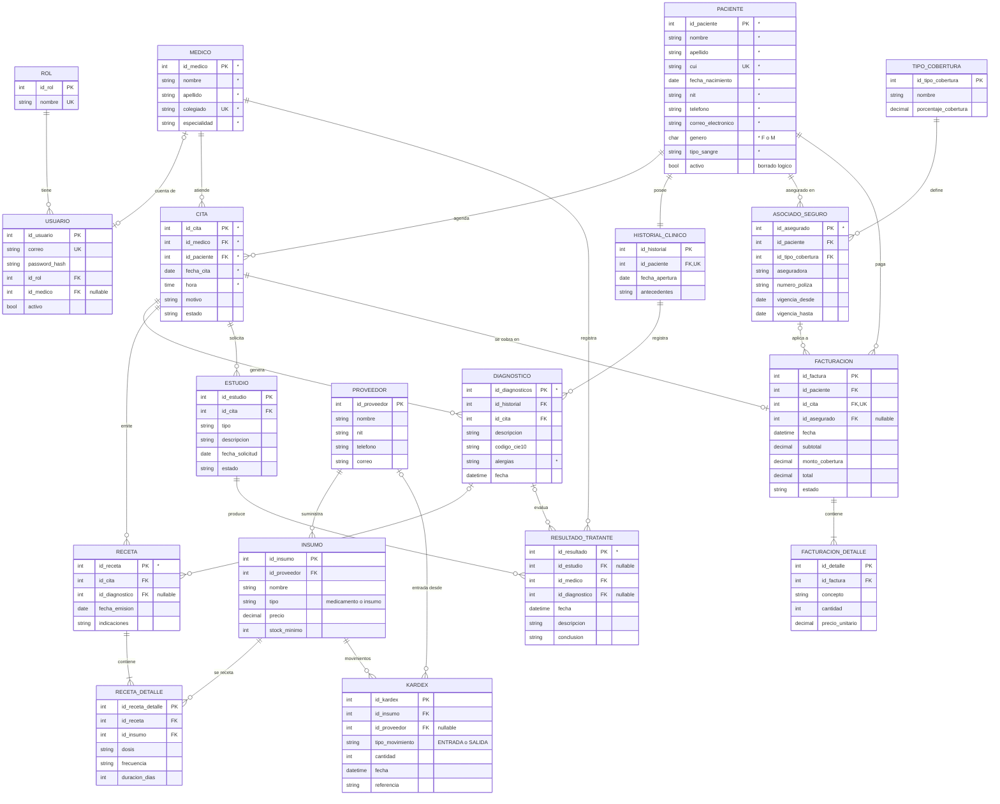

# Modelo entidad–relación (propuesta v1)

Modelo implementado: coincide tabla por tabla y columna por columna con el esquema que crean las migraciones de EF Core en MySQL. Los atributos marcados con (*) vienen de la captura del enunciado; el resto son decisiones de diseño del equipo. La imagen `docs/er/diagrama-er.png` se genera desde este diagrama con `docs/entregable/generar.mjs`.

## Diagrama

## Supuestos a validar

1. **Kardex:** el enunciado no lo define. Se interpreta como el registro de movimientos (entradas y salidas) de medicamentos e insumos, ligado a proveedores. Por eso aparece la entidad `insumo`, que no está en el enunciado.
2. **Resultados tratantes:** se modela como el resultado que registra un médico, ligado opcionalmente a un estudio y a un diagnóstico. La captura escribe `resultados_trantes`; la tabla se llamará `resultado_tratante`.
3. **Recetas:** se normalizan en cabecera y detalle, porque una receta puede incluir varios medicamentos.
4. **Historial clínico:** uno por paciente; los diagnósticos cuelgan de él y de la cita donde se hicieron.
5. **Tipo de cobertura:** catálogo de planes; `asociado_seguro` une a un paciente con un plan y una póliza.
6. **Seguridad:** `usuario` y `rol` se agregan para JWT. Un usuario puede enlazarse a un médico.
7. **Datos:** una sola base MySQL con llaves foráneas reales. Cada servicio es dueño lógico de sus tablas:
   - `clinical`: paciente, medico, cita, historial_clinico, diagnostico, receta, receta_detalle, estudio, resultado_tratante.
   - `billing`: facturacion, facturacion_detalle, asociado_seguro, tipo_cobertura.
   - `inventory`: proveedor, insumo, kardex.
   - `auth`: usuario, rol.
8. **Tipos:** `genero` acepta solo `F` o `M`, como en la captura. `cui` y `colegiado` son únicos.
